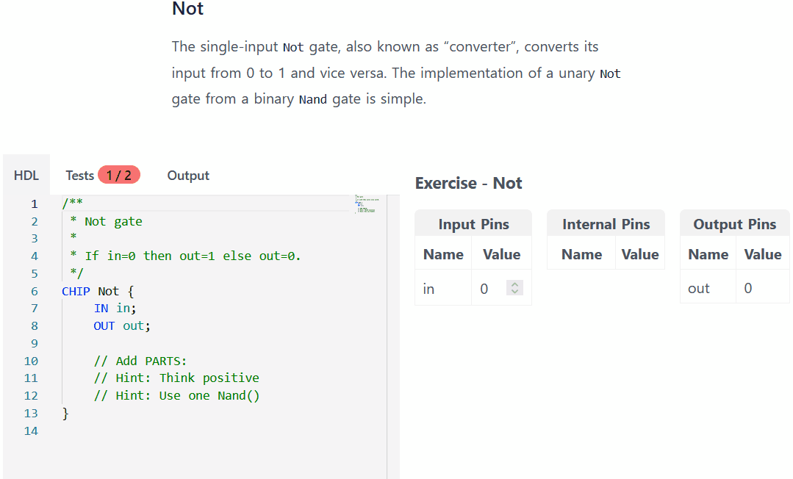

<p align="center">
  <a href="https://chipsandcode.com/">
    
  </a>
</p>

<h3 align="center">Chips and Code</h3>

<p align="center">
  Wondering how computers work? Build your own computer from scratch, from chips to code. Free in your browser, with no prerequisites.
  <br>
  <a href="https://chipsandcode.com/"><strong>Visit »</strong></a>
</p>

<p align="center">
  <a href="https://snyk.io/test/github/durasj/chipsandcode"></a>
  <a href="https://codeclimate.com/github/durasj/chipsandcode"></a>
  <a href="https://codecov.io/gh/durasj/chipsandcode" ></a>
</p>

## Features

### Build from signals to software

The homepage retains the original invitation: **“Wondering how computers work?”** A quiet, scroll-driven journey moves from dark signals and logic to light software. One learning action starts at the foundation. Parallax diagrams explain the relationship between the layers without a mission picker, playback dashboard, or editor controls on the homepage. Reduced motion uses a static presentation; mobile layouts keep each explanation with its diagram.

Learning starts with a single signal. Turn it on and off, then explore a supplied NAND gate one input combination at a time. Continue into NOT, AND, OR, XOR, Mux, and DMux. The first construction introduces adding a part, choosing a source, connecting pins, and testing the result through instructions that follow the actual circuit state.

The construction workspace begins in Visual mode. A compact view selector makes Code and Split available when wanted; saved view preferences are retained. Direct visual wiring and real HDL share one circuit model, parser, and simulator. Connection menus, hints, reference explanations, and signal analysis stay secondary. Test every input case before saving a chip. Invalid code stays editable and cannot pass a test against an older circuit.

Progress and drafts are stored on the current device. Optional reference material, original reading, and the full hardware IDE remain accessible. The current playable material is single-bit logic; arithmetic, memory, architecture, and software are the path ahead, not implemented construction layers.

A separate 48-second visual introduction is available through a quiet link at the end of the homepage. It has native video controls, captions, and a text transcript. The current film is silent; see [intro production](docs/intro-production.md) for its assets and narration status.

See the [interaction design](docs/computer-layers-design.md), [art direction](docs/art-direction.md), and [content audit](docs/content-audit.md) for the design, its relationship to the existing material, and implementation boundaries.

The animation below shows the original hardware IDE, which remains accessible from the application footer.



Contains the existing first-week Boolean logic material and six executable single-bit construction exercises. Bus and multi-way extensions are described in the reference; their construction support is planned.
Can work offline and supports installation as a PWA.
No cloud dependency for the basic functionality.

- Hardware IDE
  - Code editor with syntax highlighting
  - Test Scripts with automated evaluation
  - Visual diff of Expected & Actual output
  - Pin inspection with automated evaluation
  - Proper lexer&parser with inline syntax errors.
- Learning Content
  - Easily editable as Markdown files
  - Math support - KaTeX
  - Support for embedded Hardware IDE & YouTube videos
  - Responsive

## Planned

The overall goal is to implement all functionality needed for the first six weeks of Nand2Tetris and adapt their learning material in a simplified form. That being said, it should be done with a quality-over-quantity mindset so that it's not just a simple rewrite. Everything should be thought through, and any major usability improvements have a higher priority than content.

Major features, ordered by priority:

1. Create a chip schema diagram on the fly (#12).
1. Proper tab interface - configurable tabs, everything in the same style (#13).
1. Decimal and hexadecimal format (#14).
1. Autocomplete & interface on hover (#20).
1. Ability to sign in (#21).
1. Projects (#22).
1. 2nd week of Nand2Tetris content (#15).
1. Support for CLOCKED (#16).
1. Debug mode (stepping, "animation") accessible from the Tests tab (#17).
1. 3nd week of Nand2Tetris content (#18).
1. Hack Machine Language.
1. Hack Assembly.
1. Assembler.
1. CPU Emulator.
1. 4th week of Nand2Tetris content.
1. 5th week of Nand2Tetris content.
1. 6th week of Nand2Tetris content.

## Developing

Use Node.js 26 (`nvm use`) and install the locked dependencies:

```bash
npm ci
npm run dev
```

The app uses Svelte 5, SvelteKit 3, Vite 8, and TypeScript 6 (the current version supported by SvelteKit and svelte-check). The editor uses Monaco 0.57. UI menus and tabs use Bits UI. Tailwind 3 and daisyUI 3 support the existing course and IDE pages. The layered landing and workbench use component styles with the original indigo brand.

Lessons, built-in examples, the simulator, local drafts and ZIP downloads work without a database. Saved experiments use the same-origin SvelteKit `/api/experiments` routes and require `DATABASE_URL` from a Neon Postgres database. Copy `.env.template` to `.env.local` and set the URL locally when working on persistence. Never commit credentials or migration exports.

## Building and testing

```bash
npm run check
npm run test:unit
npm run build
npm run preview -- --host 127.0.0.1
npm run test:cy
```

The production build generates `.vercel/output` using `@sveltejs/adapter-vercel`; it does not need database credentials. Lessons and the new-experiment page are prerendered. Shared experiment pages load on the client, and the API runs on Node.js 26 functions. The PWA precaches application assets and lessons; private API responses are never cached.

Unit tests live next to the source and include parser fixtures, simulator behavior, ownership checks, origin checks and migration validation. Cypress retains the existing accessibility and visual-regression checks. CI uses Node.js 26 and `npm ci` and runs typing, coverage, builds and Cypress on pull requests.

## Deployment and data migration

See [the Vercel migration runbook](docs/vercel-migration.md) for project settings, database setup, preserving legacy experiment IDs and anonymous sessions, validation, domain cutover and rollback. Import and test the migration branch before merging it or changing production DNS.

## Browser Support

Chips and Code is designed for and tested on the latest stable versions of Chrome, Firefox, Edge, and Safari. It does not support any version of Internet Explorer.

## Background

For more information check out:

- [chipsandcode.com/about](https://chipsandcode.com/about)
- [thesis.chipsandcode.com](https://thesis.chipsandcode.com)

## License

Software: MIT License

Learning Content: [CC BY-NC-SA 3.0](https://creativecommons.org/licenses/by-nc-sa/3.0/)
